**[English](#english) | [中文](#中文)**

---

## English

# Shop Telegram Bot

A Telegram shop bot built with aiogram 3 and SQLite. Customers browse products, buy them directly or through a cart, and view their order history. Administrators add and edit products and see all orders.

### Features

- Product catalog with description, price, stock and image link
- Direct purchase with a confirmation step
- Shopping cart with stock checks (also when the cart is bought)
- Personal order history
- Admin tools: add products, edit products, view all orders
- Step-by-step dialogs built on FSM (finite state machine)

### Requirements

- Python 3.12+ (the code uses nested quotes inside f-strings)
- aiogram 3.x
- python-dotenv
- SQLite (built into Python)

### Installation and launch

1. Install the dependencies:

   ```bash
   pip install aiogram python-dotenv
   ```

2. Create a bot with [@BotFather](https://t.me/BotFather) and copy its token.
3. Create a `.env` file next to the bot file:

   ```
   BOT_TOKEN=your_telegram_bot_token
   ```

4. Run the bot:

   ```bash
   python bot2.py
   ```

### First launch

Send `/start` to the bot once. It creates the database tables (the `shop.db` file itself is created automatically). Until then the other commands will fail because the tables do not exist.

Admin rights are granted by a hidden command defined in the code. Change its name before publishing the code.

### Commands

| Command | Description | Access |
|---|---|---|
| `/start` | Create tables and show the menu | Everyone |
| `/list` | Show the product list | Everyone |
| `/buy` | Buy a product: name, quantity, confirmation (yes / no) | Everyone |
| `/cart` | Add a product to the cart | Everyone |
| `/cart_list` | Show the cart and the total price | Everyone |
| `/cart_buy` | Buy everything in the cart | Everyone |
| `/orders` | Show your own orders | Everyone |
| `/cancel` | Cancel the current action | Everyone |
| `/add` | Add a product: name, description, price, quantity, image link | Admin |
| `/update` | Edit a product field: `name`, `description`, `price`, `count` or `img` | Admin |
| `/all_orders` | Show orders of all users | Admin |

### Screenshots

**`/start`** — welcome message with the list of commands, including the admin ones

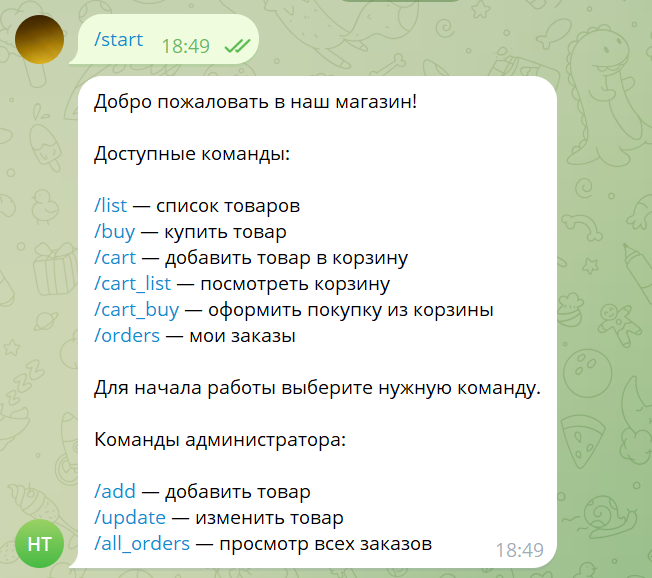

**`/add`** (admin) — step-by-step dialog: name, description, price, quantity, image link

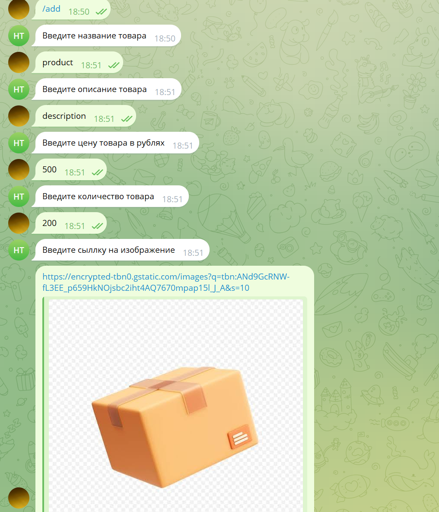

**`/add`** (admin) — confirmation with the saved product

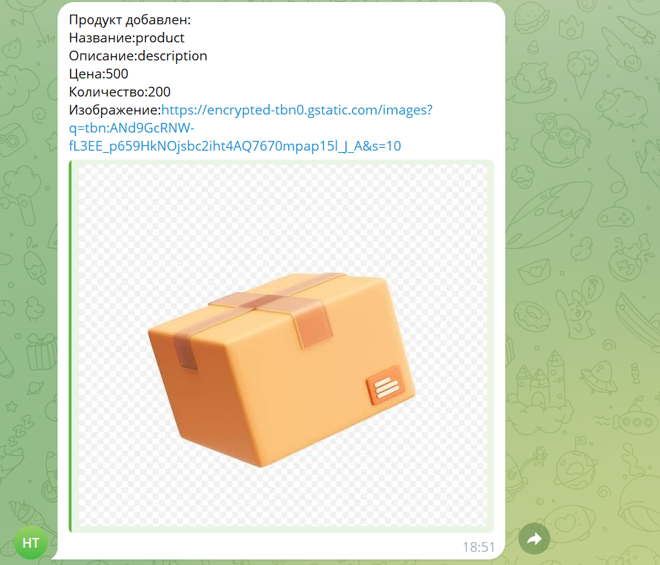

**`/list`** — product list

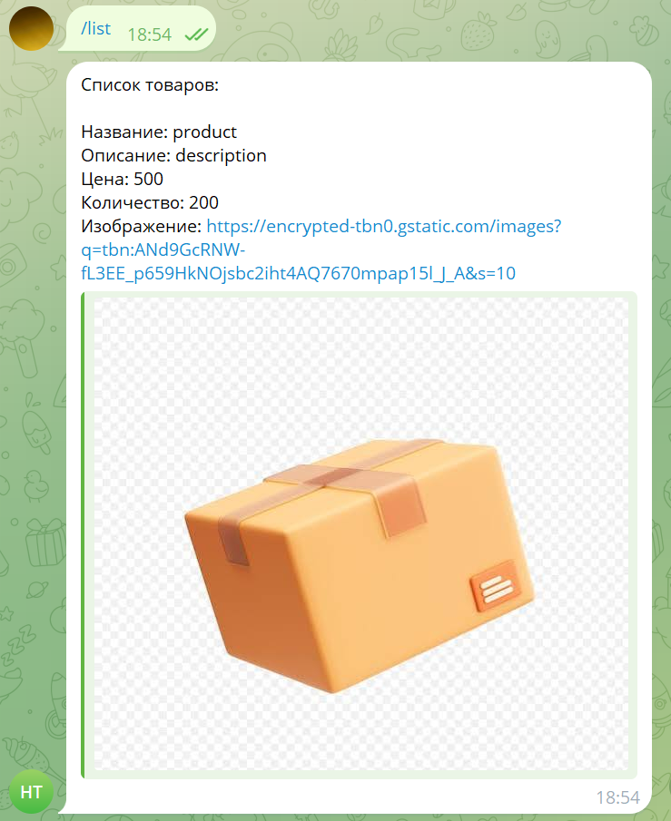

**`/buy`** — choosing a product and entering the quantity (the stock is shown)

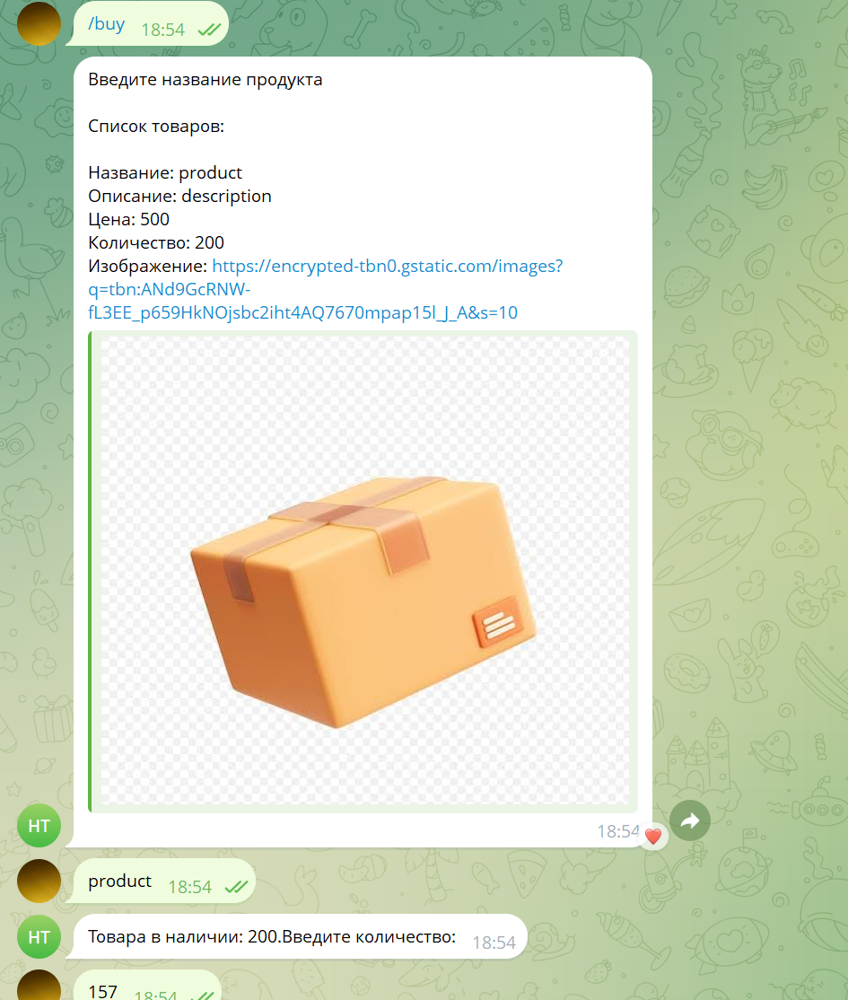

**`/buy`** — total price and the "да" (yes) confirmation

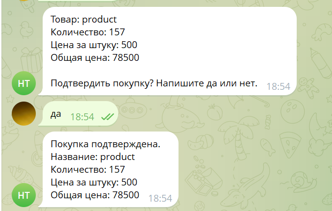

**`/cart`** — adding a product to the cart

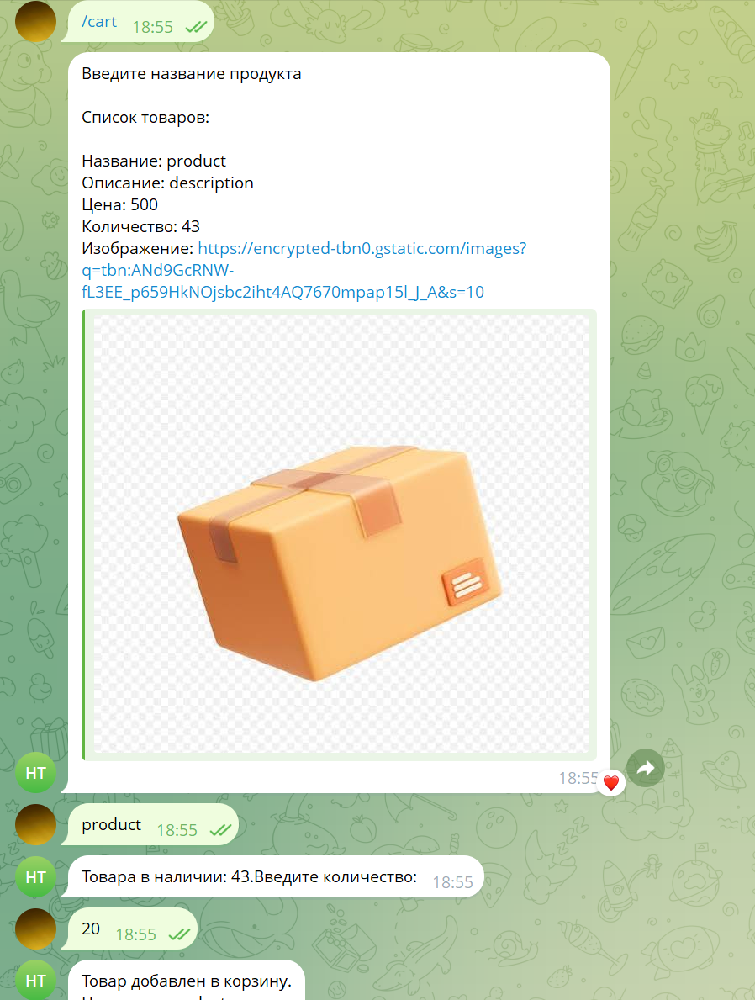

**`/cart_list`** — the cart and the total price

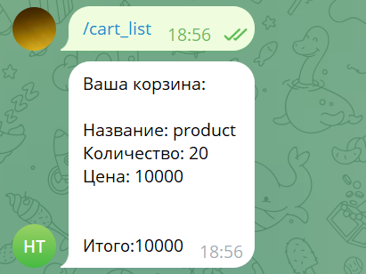

**`/cart_buy`** — buying everything in the cart

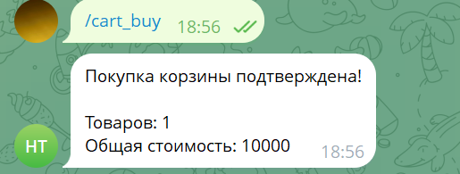

**`/orders`** — personal order history

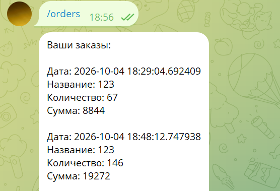

**`/update`** (admin) — editing a product field

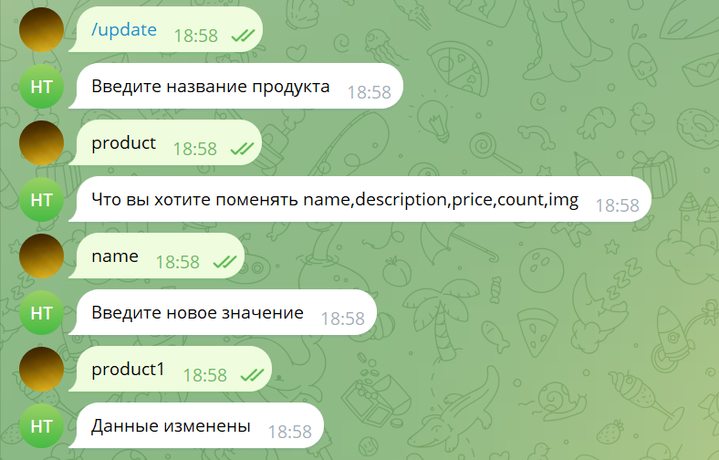

**`/all_orders`** (admin) — orders of all users

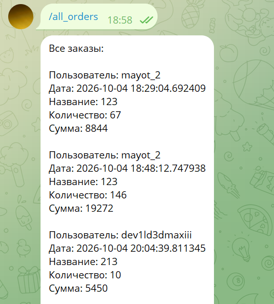

### Project structure

```
parent-folder/
├── shop.db              # SQLite database, created on the first launch
└── shop-bot/            # start the bot from this folder
    ├── bot2.py          # the bot: FSM states and command handlers
    ├── utils.py         # helper functions used by bot2.py
    ├── .env             # BOT_TOKEN (keep it out of the repository)
    ├── README.md
    └── images/          # screenshots for this README
```

The database path in the code is `../shop.db`. SQLite resolves it from the folder the bot is started from, so the file appears one level above the project folder.

#### bot2.py

The file reads from top to bottom in this order:

1. **Setup** — loads `.env`, creates `Bot` and `Dispatcher`, opens the database. The connection `data` and the cursor `cur` are module-level globals shared by all handlers.
2. **`main()`** — prints a start message and runs polling.
3. **State groups** — one `StatesGroup` per dialog (see the table below).
4. **Handlers** — one function per command or dialog step, registered with `@dp.message(...)`.
5. The last line, `asyncio.run(main())`, starts the bot.

State groups:

| Group | Steps | Command |
|---|---|---|
| `AddProduct` | `name` → `description` → `price` → `count` → `img` | `/add` |
| `EditProduct` | `name` → `edit` → `edit_text` | `/update` |
| `BuyProduct` | `name` → `count` → `confirm` | `/buy` |
| `CartProduct` | `name` → `count` | `/cart` |

Each step is a separate handler: the bot saves the answer with `state.update_data(...)` and moves on with `state.set_state(...)`. `/cancel` clears the state at any step.

Handlers:

| Command | What the handlers do |
|---|---|
| `/start` | Creates the tables, runs the `clear_empty` cleanup and shows the menu; the admin part of the menu is shown only to admins |
| `/cancel` | Resets the current dialog |
| `/add` | Admin only. Checks that the name is unique and that price and quantity are numbers above zero, then inserts a row into `shop` |
| `/update` | Admin only. Asks for the product, the field and the new value; `price` and `count` must be numbers above zero |
| `/list` | Prints all products |
| `/buy` | Checks the product and the stock, shows the total and, after "да", calls `make_order` |
| `/cart` | Shows the free stock (stock minus what is already in the user's cart) and inserts a row into `cart` if the total fits |
| `/cart_list` | Prints the user's cart and the total |
| `/cart_clear` | Removes everything from the user's cart (not listed in the `/start` menu) |
| `/cart_buy` | Sums the quantities of equal products, checks the stock for each, then calls `make_order` for every cart row |
| `/orders` | Prints the user's orders |
| `/all_orders` | Admin only. Prints all orders; usernames come from `bot.get_chat` |
| hidden admin command | Adds the current user to the `admin` table; its name is set in the code |

#### utils.py

Helpers imported into `bot2.py` with `from utils import *`:

| Function | Used for |
|---|---|
| `create_tables(data)` | Creates the four tables on `/start` |
| `clear_empty(data)` | Cleanup called after `/start`, purchases and edits |
| `check_admin(message, cur)` | Tells whether the sender is an admin; used by `/start`, `/add`, `/update` and `/all_orders` |
| `check_name(message, cur)` | Tells whether a product name is already taken |
| `check_number(text)` | Returns the number, or `None` if the text is not a number above zero |
| `get_products_text(cur)` | Builds the product list text for `/list`, `/buy` and `/cart` |
| `make_order(user, name, count, data, cur)` | Creates the order and returns the price per item and the total |

### How it works

- **Buying a product.** The bot checks that the product exists, asks for the quantity, checks the stock, shows the total price and waits for the confirmation. After "да" (yes) it saves the order and decreases the stock.
- **Cart.** When adding a product, the bot counts what is already in the cart, so the total never exceeds the stock. `/cart_buy` checks the stock again, creates the orders, decreases the stock and clears the cart. If any product is out of stock, nothing is bought.
- **Validation.** Price must be greater than zero, quantity of a new product must be greater than zero, and product names are unique.

### Database

SQLite file `shop.db` with four tables:

| Table | Columns |
|---|---|
| `shop` | `id`, `name` (unique), `description`, `img`, `price`, `count` |
| `orders` | `id`, `user`, `date`, `name`, `tot_price`, `count` |
| `cart` | `id`, `user`, `name`, `count`, `price` |
| `admin` | `id`, `user_id` (unique) |

### Notes

- Prices are in rubles.
- There is no online payment: a confirmed purchase is saved as an order and the stock is decreased.
- The interface language of the bot is Russian.

---

## 中文

# 商店 Telegram 机器人

基于 aiogram 3 和 SQLite 的 Telegram 商店机器人。顾客可以浏览商品，直接购买或通过购物车购买，并查看自己的订单记录。管理员可以添加和修改商品，并查看所有订单。

### 功能

- 商品目录，包含描述、价格、库存和图片链接
- 带确认步骤的直接购买
- 带库存检查的购物车（购买购物车时会再次检查）
- 个人订单记录
- 管理员工具：添加商品、编辑商品、查看所有订单
- 基于 FSM（有限状态机）的分步对话

### 环境要求

- Python 3.12+（代码在 f-string 中使用了嵌套的同类引号）
- aiogram 3.x
- python-dotenv
- SQLite（Python 内置）

### 安装与运行

1. 安装依赖：

   ```bash
   pip install aiogram python-dotenv
   ```

2. 通过 [@BotFather](https://t.me/BotFather) 创建机器人并复制其令牌（token）。
3. 在机器人文件旁边创建 `.env` 文件：

   ```
   BOT_TOKEN=your_telegram_bot_token
   ```

4. 运行机器人：

   ```bash
   python bot2.py
   ```

### 首次启动

请先向机器人发送一次 `/start`，它会创建数据库表（`shop.db` 文件会自动创建）。在此之前，其他命令会因为缺少数据表而报错。

管理员权限通过代码中的一条隐藏命令获得。公开代码之前请修改该命令的名称。

### 命令

| 命令 | 说明 | 权限 |
|---|---|---|
| `/start` | 创建数据表并显示菜单 | 所有人 |
| `/list` | 显示商品列表 | 所有人 |
| `/buy` | 购买商品：名称、数量、确认（是 / 否） | 所有人 |
| `/cart` | 将商品加入购物车 | 所有人 |
| `/cart_list` | 显示购物车和总价 | 所有人 |
| `/cart_buy` | 购买购物车中的所有商品 | 所有人 |
| `/orders` | 显示自己的订单 | 所有人 |
| `/cancel` | 取消当前操作 | 所有人 |
| `/add` | 添加商品：名称、描述、价格、数量、图片链接 | 管理员 |
| `/update` | 修改商品字段：`name`、`description`、`price`、`count` 或 `img` | 管理员 |
| `/all_orders` | 显示所有用户的订单 | 管理员 |

### 截图

**`/start`** — 欢迎消息和命令列表（包含管理员命令）


**`/add`**（管理员）— 分步对话：名称、描述、价格、数量、图片链接


**`/add`**（管理员）— 已保存商品的确认信息


**`/list`** — 商品列表


**`/buy`** — 选择商品并输入数量（显示库存）


**`/buy`** — 显示总价，回复“да”（是）确认购买


**`/cart`** — 将商品加入购物车


**`/cart_list`** — 购物车和总价


**`/cart_buy`** — 购买购物车中的所有商品


**`/orders`** — 个人订单记录


**`/update`**（管理员）— 修改商品字段


**`/all_orders`**（管理员）— 所有用户的订单


### 项目结构

```
parent-folder/
├── shop.db              # SQLite 数据库，首次启动时创建
└── shop-bot/            # 从这个文件夹启动机器人
    ├── bot2.py          # 机器人本体：FSM 状态和命令处理函数
    ├── utils.py         # bot2.py 使用的辅助函数
    ├── .env             # BOT_TOKEN（不要提交到仓库）
    ├── README.md
    └── images/          # 本 README 使用的截图
```

代码中的数据库路径是 `../shop.db`。SQLite 会从启动机器人的文件夹开始解析这个相对路径，所以数据库文件会出现在项目文件夹的上一级。

#### bot2.py

文件从上到下依次包含：

1. **初始化** — 加载 `.env`，创建 `Bot` 和 `Dispatcher`，打开数据库。连接 `data` 和游标 `cur` 是模块级全局变量，所有处理函数共用。
2. **`main()`** — 打印启动提示并开始轮询。
3. **状态组** — 每个对话场景对应一个 `StatesGroup`（见下表）。
4. **处理函数** — 每个命令或对话步骤对应一个函数，用 `@dp.message(...)` 注册。
5. 最后一行 `asyncio.run(main())` 启动机器人。

状态组：

| 状态组 | 步骤 | 命令 |
|---|---|---|
| `AddProduct` | `name` → `description` → `price` → `count` → `img` | `/add` |
| `EditProduct` | `name` → `edit` → `edit_text` | `/update` |
| `BuyProduct` | `name` → `count` → `confirm` | `/buy` |
| `CartProduct` | `name` → `count` | `/cart` |

每个步骤是单独的处理函数：机器人用 `state.update_data(...)` 保存回答，用 `state.set_state(...)` 进入下一步。`/cancel` 可以在任何一步清除状态。

处理函数：

| 命令 | 处理函数的作用 |
|---|---|
| `/start` | 创建数据表，执行 `clear_empty` 清理并显示菜单；菜单中的管理员部分只对管理员显示 |
| `/cancel` | 重置当前对话 |
| `/add` | 仅管理员。检查名称不重复、价格和数量是大于零的数字，然后向 `shop` 表插入一行 |
| `/update` | 仅管理员。依次询问商品、字段和新值；`price` 和 `count` 必须是大于零的数字 |
| `/list` | 显示所有商品 |
| `/buy` | 检查商品和库存，显示总价，回复“да”后调用 `make_order` |
| `/cart` | 显示可用库存（库存减去用户购物车中已有的数量），数量合适时向 `cart` 表插入一行 |
| `/cart_list` | 显示用户的购物车和总价 |
| `/cart_clear` | 清空用户的购物车（不在 `/start` 菜单中） |
| `/cart_buy` | 合并相同商品的数量，逐个检查库存，然后对购物车中的每一行调用 `make_order` |
| `/orders` | 显示用户自己的订单 |
| `/all_orders` | 仅管理员。显示所有订单；用户名通过 `bot.get_chat` 获取 |
| 隐藏的管理员命令 | 将当前用户添加到 `admin` 表；命令名称在代码中设置 |

#### utils.py

通过 `from utils import *` 导入 `bot2.py` 的辅助函数：

| 函数 | 用途 |
|---|---|
| `create_tables(data)` | 在 `/start` 时创建四张数据表 |
| `clear_empty(data)` | 在 `/start`、购买和编辑之后调用的清理函数 |
| `check_admin(message, cur)` | 判断发送者是否是管理员；用于 `/start`、`/add`、`/update` 和 `/all_orders` |
| `check_name(message, cur)` | 判断商品名称是否已被占用 |
| `check_number(text)` | 返回该数字；如果文本不是大于零的数字则返回 `None` |
| `get_products_text(cur)` | 生成 `/list`、`/buy` 和 `/cart` 使用的商品列表文本 |
| `make_order(user, name, count, data, cur)` | 创建订单并返回单价和总价 |

### 工作原理

- **购买商品。** 机器人检查商品是否存在，询问数量，检查库存，显示总价并等待确认。回复“да”（是）后保存订单并减少库存。
- **购物车。** 添加商品时，机器人会计算购物车中已有的数量，因此总数不会超过库存。`/cart_buy` 会再次检查库存，创建订单，减少库存并清空购物车。如果任何一件商品库存不足，则不会购买任何商品。
- **输入验证。** 价格必须大于零，新商品的数量必须大于零，商品名称不能重复。

### 数据库

SQLite 文件 `shop.db`，包含四张表：

| 表 | 列 |
|---|---|
| `shop` | `id`、`name`（唯一）、`description`、`img`、`price`、`count` |
| `orders` | `id`、`user`、`date`、`name`、`tot_price`、`count` |
| `cart` | `id`、`user`、`name`、`count`、`price` |
| `admin` | `id`、`user_id`（唯一） |

### 说明

- 价格以卢布为单位。
- 没有在线支付：确认购买后只会保存订单并减少库存。
- 机器人的界面语言为俄语。